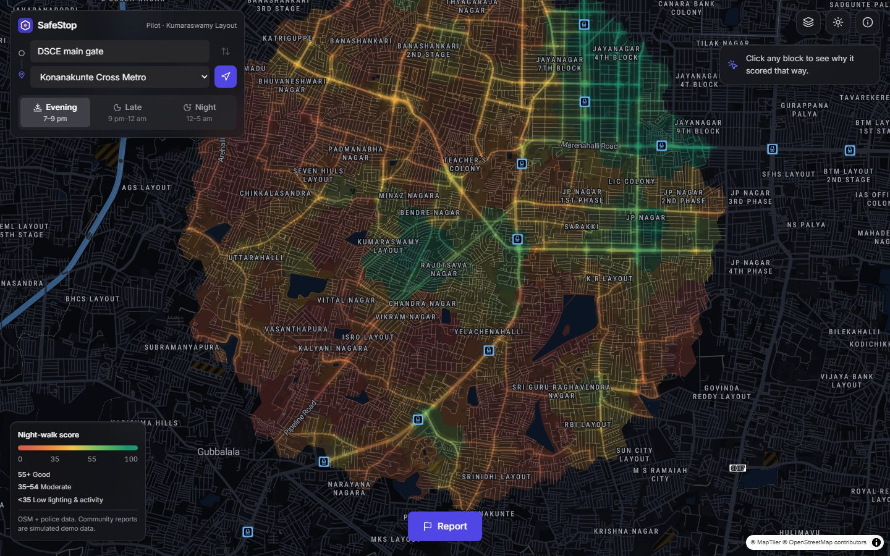
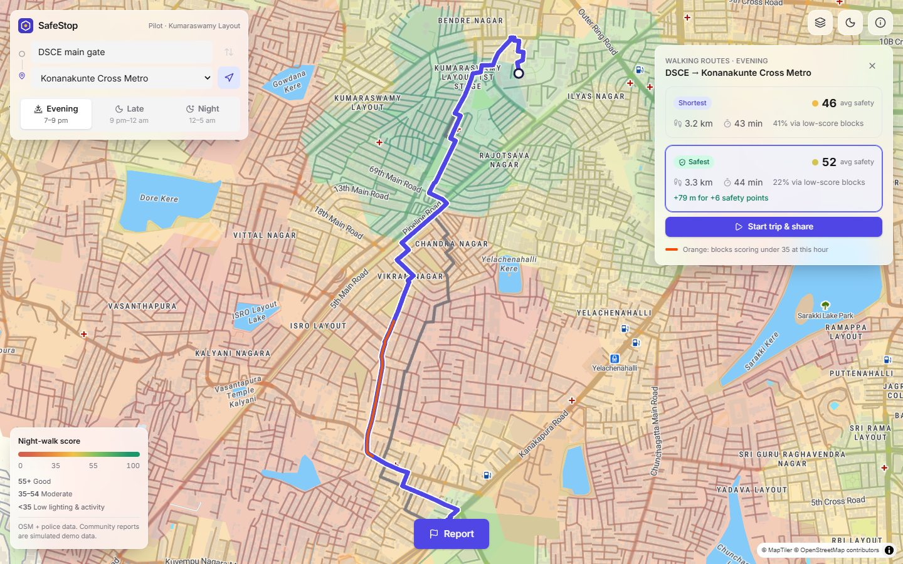
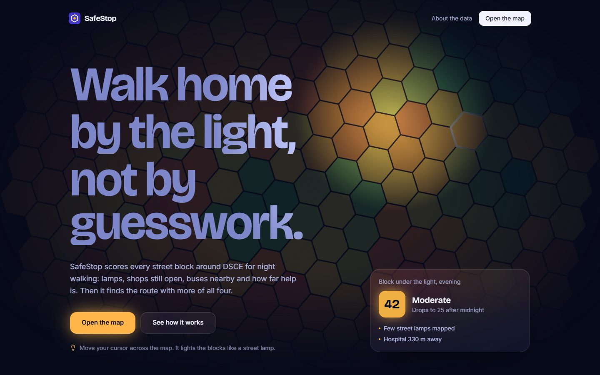

# SafeStop · presentation prototype

Night-time walking scores for every street block within 3 km of DSCE, Bengaluru. Frontend only. Data is precomputed into `public/data/` (see `public/data/README.md`).



| Route planner: shortest vs safest | Landing page |
|---|---|
|  |  |

*Community reports shown in the app are simulated demo data.*

## Run (PowerShell)

```powershell
npm install
npm run dev                          # http://localhost:5173
npm run build; npm run preview       # check the production build before presenting
```

## Rebuild the data (optional, needs internet)

```powershell
py -m pip install requests h3 shapely numpy pandas
py scripts/fetch_real.py             # add --cached to reuse scripts/input/osm_raw.json
py scripts/build_scores.py
py scripts/make_synthetic_reports.py
py scripts/fetch_routes.py
py scripts/make_street_preview.py
py scripts/make_street_scores.py
```

## Nicer base map (optional)

Uses OpenFreeMap (no key) by default. For MapTiler, get a free key at maptiler.com, copy `.env.example` to `.env.local` and fill it in:

```
VITE_MAPTILER_KEY=your_key_here
VITE_MAPTILER_STYLE=streets-v4       # optional; e.g. dataviz-v4. Dark mode adds "-dark".
```

Restart `npm run dev` after adding it. If the key is restricted to certain origins, allow `localhost` (and your deploy domain). If MapTiler fails, the map falls back to OpenFreeMap, then to a plain offline background.

Police KML files go in `scripts/input/` (already downloaded from data.opencity.in).

## Demo flow

1. Landing → **Open the map**
2. Switch **Evening → Night**: street colours change as shops close
3. Click a red/orange street or block → **Why this score**
4. Press the blue arrow next to *Konanakunte Cross Metro* → compare **Shortest** vs **Safest**, select Safest
5. **Report** → pick a category → **Submit anonymously** → toast shows the score change
6. **Back** → **Start trip & share** → walker moves → "Stopped for 3 min" alert
7. **i** button (top right) → About page: data sources and formula

## Map views

Streets are coloured by their block's score, over a faint tint of the H3 blocks. The **Layers** button (top right) switches **Coloured streets** and **Score blocks** on or off. A block gets an outline only when you click it. Dark and light mode use separate colour strengths (`src/components/map/SafetyMap.tsx`, `src/lib/mapStyle.ts`).

Base map tiles need internet. If MapTiler fails the map uses OpenFreeMap, and if that fails within 15 s, a plain background; streets, blocks, routes and panels still work.
